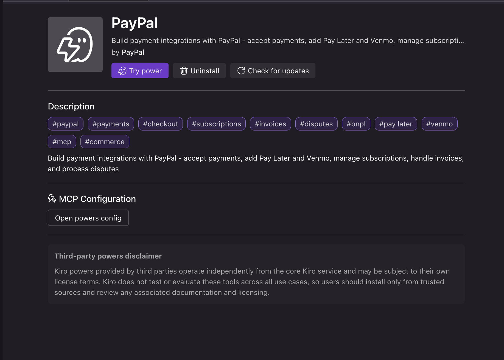
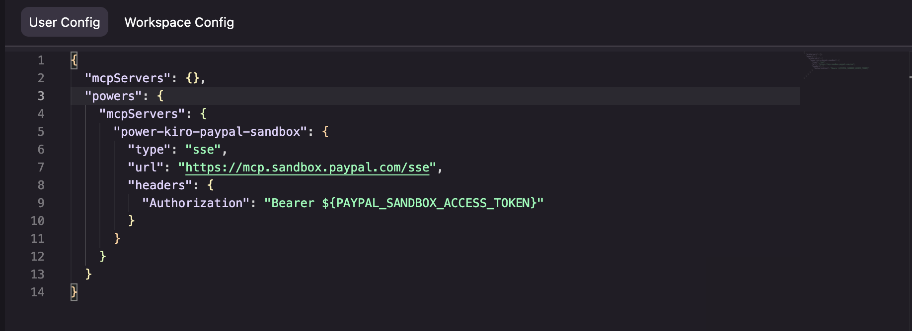

# PayPal Payments Best Practices

## Overview

Build payment integrations with PayPal's developer platform. Accept one-time payments and subscriptions, add Pay Later and Venmo, manage invoices, process refunds, and handle disputes. This skill provides integration guidance for PayPal's JS SDK (v5 and v6); when the `paypal-sandbox` MCP server (see `mcp.json`) is connected, prefer its tools for live sandbox operations.

**Key capabilities:**

- **Checkout**: Accept one-time payments with PayPal Buttons, Advanced Card Fields, and Expanded Checkout
- **Pay Later**: Add BNPL messaging and Pay in 4 / installment financing
- **Venmo**: Add Venmo as a funding source with eligibility checks
- **Subscriptions**: Recurring billing with plan management, trials, and upgrades/downgrades
- **Invoicing**: Generate and send invoices with reminders and partial payments
- **Disputes & Refunds**: Manage the dispute lifecycle and process full or partial refunds
- **Payouts**: Send batch payouts to sellers or partners
- **Fastlane**: Accelerated guest checkout (PayPal-direct or Braintree gateway variants)
- **Agentic Commerce**: Store Sync and AI shopping agent integrations

**Authentication**: Requires a PayPal sandbox `client_id`/`client_secret` to generate an OAuth access token for the MCP server. Never expose credentials in client-side code.

See `references/` for topic-specific guidance:

[3d-secure.md](references/3d-secure.md), [agentic-commerce.md](references/agentic-commerce.md), [authentication.md](references/authentication.md), [bnpl.md](references/bnpl.md), [checkout.md](references/checkout.md), [disputes-refunds.md](references/disputes-refunds.md), [expanded-checkout.md](references/expanded-checkout.md), [fastlane-braintree.md](references/fastlane-braintree.md), [fastlane.md](references/fastlane.md), [invoicing.md](references/invoicing.md), [js-sdk-v6.md](references/js-sdk-v6.md), [mcp-tools.md](references/mcp-tools.md), [payouts.md](references/payouts.md), [subscriptions.md](references/subscriptions.md), [venmo.md](references/venmo.md), [webhook-sandbox.md](references/webhook-sandbox.md), [webhooks.md](references/webhooks.md)

## Using the paypal-sandbox MCP Server

**Setup note:** after installing this power, set the token on the _installed_ power's MCP config — open the power in Kiro's Powers panel and click **"Open powers config"** — not the top-level `.kiro/settings/mcp.json`. Editing the settings file only affects what the sidebar displays; the installed-power copy is what Kiro actually uses when invoking a tool.




**Tool inventory:** orders/payments (`create_order`, `pay_order`, `get_order`), invoices (create, send, list, reminders, QR codes), subscriptions (plans, create, update, cancel), disputes (`list_disputes`, `get_dispute`, `accept_dispute_claim`), refunds (`create_refund`, `get_refund`), catalog (`create_product`, `update_product`, `list_products`, `show_product_details`), shipment tracking, and reporting (`list_transactions`, `get_merchant_insights`).

## Best Practices

### Integration Approach

**Detect SDK version before generating code:**

- **v5** — `sdk/js?client-id=` script tag, `paypal.Buttons()`, Hosted Fields → use checkout / expanded-checkout guidance
- **v6** — `web-sdk/v6/core` script tag, `createInstance`, `<paypal-button>` web components → use JS SDK v6 guidance
- **New project** (no existing SDK) — default to v6
- **Unclear** — ask which version is in use

**Never use deprecated APIs** — no NVP/SOAP, v1/payments, Hosted Fields, or Adaptive Payments.

**Fastlane** has three distinct variants (Braintree gateway, PayPal-direct v5, PayPal-direct v6) — pick exactly one, do not mix; ask if unclear which is in use.

### MCP Boundary

When the PayPal MCP server is connected, prefer MCP tools for live operations (creating orders, managing subscriptions, fetching disputes). Use this skill's guidance for architecture decisions and code generation — not for executing API calls that MCP tools can handle directly.

### Pre-Delivery Checklist

Before presenting generated PayPal integration code, verify:

- [ ] Credentials are not hardcoded (use env vars, see [Configuration](#configuration))
- [ ] `PayPal-Request-Id` included on all POST requests (idempotency)
- [ ] Sandbox URLs used (not production) in examples
- [ ] Webhook signature verification is present (see [Troubleshooting](#troubleshooting))
- [ ] `intent` matches the use case (CAPTURE vs AUTHORIZE)
- [ ] BNPL messaging only rendered for eligible countries/currencies (see [Troubleshooting](#troubleshooting))
- [ ] Venmo eligibility check before rendering the Venmo button (see [Troubleshooting](#troubleshooting))
- [ ] Server-side order creation (not client-side `actions.order.create()`)
- [ ] Error handling for `INSTRUMENT_DECLINED` (422) and retry with exponential backoff for 429 (see [Troubleshooting](#troubleshooting))
- [ ] `debug_id` logged from error responses
- [ ] Token caching implemented (see [Configuration](#configuration)); Apple Pay domain verification mentioned if Apple Pay is used

## Common Workflows

### Workflow 1: Accept a One-Time Payment

```javascript
// Step 1: Create the order server-side (never client-side actions.order.create())
const order = create_order({
  intent: "CAPTURE",
  purchase_units: [{ amount: { currency_code: "USD", value: "29.99" } }],
});

// Step 2: Render PayPal Buttons client-side with order.id
// Step 3: On approval, capture payment
const captured = pay_order({ order_id: order.id });
```

### Workflow 2: Create a Subscription

```javascript
// Step 1: Create a subscription plan (one-time setup per product tier)
const plan = create_subscription_plan({
  product_id: "PROD-XXXX",
  billing_cycles: [{ frequency: { interval_unit: "MONTH", interval_count: 1 } }],
});

// Step 2: Create the subscription for a specific subscriber
const subscription = create_subscription({ plan_id: plan.id });

// Step 3: Redirect subscriber to subscription.links (approve URL)
```

### Workflow 3: Process a Refund

```javascript
// Step 1: Look up the captured payment/order
const order = get_order({ order_id: "5O190127TN364715T" });

// Step 2: Create full or partial refund
const refund = create_refund({
  capture_id: order.capture_id,
  amount: { currency_code: "USD", value: "10.00" }, // omit for full refund
});
```

### Workflow 4: Handle a Dispute

```javascript
// Step 1: List open disputes
const disputes = list_disputes({ status: "WAITING_FOR_SELLER_RESPONSE" });

// Step 2: Get full dispute details
const dispute = get_dispute({ dispute_id: disputes[0].dispute_id });

// Step 3: Accept the claim if valid (or provide evidence via PayPal dashboard for contested cases)
accept_dispute_claim({ dispute_id: dispute.dispute_id, note: "Accepting per customer request" });
```

### Workflow 5: Send an Invoice

```javascript
// Step 1: Create the invoice
const invoice = create_invoice({
  recipient_email: "customer@example.com",
  items: [
    { name: "Consulting", quantity: 1, unit_amount: { currency_code: "USD", value: "150.00" } },
  ],
});

// Step 2: Send it
send_invoice({ invoice_id: invoice.id });

// Step 3 (optional): Send a reminder if unpaid after the due date
send_invoice_reminder({ invoice_id: invoice.id });
```

## Configuration

**Authentication required:** PayPal sandbox `client_id` and `client_secret` (from the [PayPal Developer Dashboard](https://developer.paypal.com/dashboard/)), exchanged for an OAuth access token.

**Setup steps:**

1. Create a PayPal Developer account and sandbox app at https://developer.paypal.com/dashboard/
2. Copy the sandbox app's `client_id` and `client_secret`
3. Exchange them for an access token — read the secret into a variable instead of typing it inline, so it never lands in your shell history:
   ```bash
   read -r PAYPAL_CLIENT_ID
   read -rs PAYPAL_CLIENT_SECRET   # -s hides input; press enter after pasting

   curl https://api-m.sandbox.paypal.com/v1/oauth2/token \
     -H "Accept: application/json" \
     -u "$PAYPAL_CLIENT_ID:$PAYPAL_CLIENT_SECRET" \
     -d "grant_type=client_credentials"
   ```
4. Cache and refresh the token proactively rather than fetching one per request
5. Set the token on the **installed power's** MCP config (see [Using the paypal-sandbox MCP Server](#using-the-paypal-sandbox-mcp-server) above) — not `.kiro/settings/mcp.json`

**Permissions:** `client_secret` has full sandbox API access — never expose it client-side or commit it to version control.

## Troubleshooting

### Error: MCP tools return `401` / "Token signature verification failed"

**Cause:** Token was set on `.kiro/settings/mcp.json` instead of the installed power's own config.
**Solution:** Open the power from the Powers panel → **"Open powers config"** → set `mcpServers.paypal-sandbox.headers.Authorization` there. The sidebar showing "Connected (N tools)" does not mean the token is actually wired up.

### Error: `INSTRUMENT_DECLINED` (422)

**Cause:** The buyer's funding instrument was declined by PayPal or the issuer.
**Solution:** Prompt the buyer to select a different funding source and retry — PayPal Buttons handles this automatically via `restart()` if using the standard integration.

### Error: BNPL / Pay Later messaging not rendering

**Cause:** BNPL is only eligible for specific country/currency combinations.
**Solution:** Verify the buyer's country and the transaction currency against PayPal's [BNPL eligibility](https://developer.paypal.com/docs/checkout/pay-later/us/) before rendering messaging.

### Error: Venmo button not appearing

**Cause:** Venmo eligibility wasn't checked before rendering, or the buyer/merchant doesn't meet Venmo's requirements (US only, specific browsers/devices).
**Solution:** Check Venmo eligibility via the SDK before rendering the button; don't render it unconditionally.

### Error: Webhook signature verification fails

**Cause:** Verifying against the wrong environment's webhook ID, or not verifying at all.
**Solution:** Use the sandbox webhook ID for sandbox events, production webhook ID for live events, and always verify signatures server-side before acting on a webhook payload.

## Resources

- [Developer Dashboard](https://developer.paypal.com/dashboard/)
- [REST API reference](https://developer.paypal.com/api/rest/)
- [MCP quickstart](https://developer.paypal.com/tools/mcp-server/)
- [JS SDK v6 docs](https://developer.paypal.com/sdk/) / [JS SDK v5 reference](https://developer.paypal.com/sdk/js/v5/reference.md)
- [BNPL / Pay Later](https://developer.paypal.com/docs/checkout/pay-later/us/)
- [Sandbox testing accounts](https://developer.paypal.com/dashboard/accounts)
